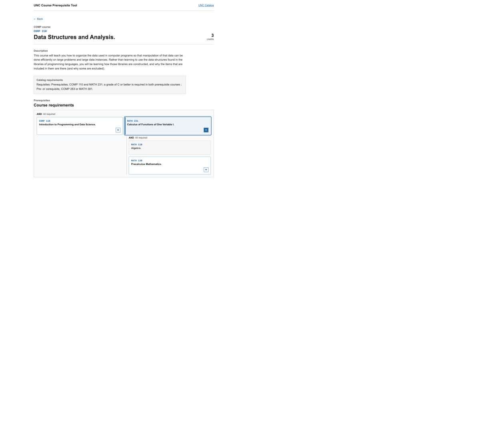
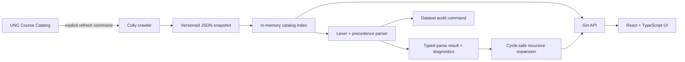

# UNC Course Explorer

A full-stack course-catalog explorer that converts semi-structured UNC requisite text into explicit AND/OR expressions and presents those relationships as progressively expandable prerequisite paths.



## Why this project exists

The official catalog shows requisites as text. A student reading one course can see its immediate prerequisites, but following a prerequisite chain requires repeatedly opening other catalog entries. This project turns supported course conditions into a navigable graph while preserving the original wording and clearly marking anything the deterministic grammar does not structure.

For example:

```text
Prerequisites, COMP 210, 211, and 301; or COMP 401, 410, and 411
```

becomes:

```text
OR(
  AND(COMP 210, COMP 211, COMP 301),
  AND(COMP 401, COMP 410, COMP 411)
)
```

## Architecture



The backend has three explicit commands:

- `serve` loads the local snapshot and starts the API.
- `audit` parses every requisite-bearing record and validates recursive expansion.
- `refresh` crawls the official catalog and writes a new timestamped snapshot.

Application startup never requires UNC availability, MongoDB, or another external service.

## Evidence from the current snapshot

The committed [audit report](reports/parser-audit.json) is generated from the exact SHA-256 hash of `data/courses.json`.

| Measure | Result |
| --- | ---: |
| Courses | 9,680 |
| Subject categories | 150 |
| Records with requisite text | 2,619 |
| Complete course-expression parses | 1,559 (59.5%) |
| Partial parses with a usable course expression | 987 (37.7%) |
| Records without a usable course expression | 73 (2.8%) |
| Records producing a structured expression | 2,546 (97.2%) |

“Partial” is intentional and visible. It means the parser produced a course expression but retained at least one unsupported or ambiguous condition—such as instructor permission, grade requirements, placement, or major restrictions—as a diagnostic. It does not mean the text was silently accepted.

Graph event counts in the audit report are observations across repeated expansion from every requisite-bearing root course. They are not unique-course counts.

## Run locally

Requirements:

- Go 1.21 or newer
- Node.js 18.18 or newer (Node.js 20 LTS recommended)
- pnpm

Start the API:

```fish
go run . serve
```

In another terminal, start the web client:

```fish
cd web
pnpm install
pnpm dev
```

Open [http://localhost:5173](http://localhost:5173).

The API defaults to `http://localhost:8080`. Set `VITE_API_BASE_URL` before `pnpm dev` to use another address.

## Verify

Backend tests and static analysis:

```fish
go test ./...
go vet ./...
```

Frontend checks:

```fish
cd web
pnpm test
pnpm lint
pnpm build
```

Regenerate the full snapshot audit:

```fish
go run . audit --depth 6 --output reports/parser-audit.json
```

Tests cover list conjunctions, operator precedence, inherited subject codes, parentheses, corequisites, unsupported text, cycle detection, depth limits, missing catalog references, API validation, CORS, search ranking, natural course-number ordering, pagination, snapshot metadata, and prerequisite-option presentation.

## Refresh catalog data

```fish
go run . refresh
```

This writes `data/courses.json` and `data/metadata.json`. The refresh command fails instead of writing an empty snapshot if the upstream HTML no longer matches the crawler. Review the diff and rerun the audit before publishing refreshed metrics.

The current committed snapshot originated in the earlier project version, whose collection timestamp was not recorded. That provenance limitation is stated in `data/metadata.json`; a newly refreshed snapshot records an RFC 3339 timestamp automatically.

## API

| Endpoint | Purpose |
| --- | --- |
| `GET /api/health` | Snapshot size and parser version |
| `GET /api/courses?q=COMP&limit=30&page=1` | Paginated ranked search with total result and page counts; code prefixes precede title matches and course numbers use natural numeric order |
| `GET /api/courses/COMP/210?depth=6` | Course detail, parse result, diagnostics, and dependency tree |

Recursive depth is bounded from 0 through 12. CORS uses an explicit allowlist supplied through the `serve --origin` flag.

Search results use 30-item pages. Short result sets show every page number, while long result sets keep the first, current, and last pages visible with ellipses between omitted ranges.

The student interface requests one prerequisite level initially. AND requirements appear as independent columns that can remain open together. OR requirements use a single-select dropdown and render only the selected branch. Opening a course requests one additional level and caches that response for the lifetime of the detail view; courses without another prerequisite level remain static and show no expand control. Narrow screens stack all paths into one column. Parser diagnostics remain available through the API and audit report without competing with student-facing course content.

## Parser boundary

The parser is deterministic; it is not an LLM and does not claim to understand arbitrary natural language. Its supported structure is deliberately narrow:

- explicit course references such as `COMP 210`;
- inherited subject codes such as `COMP 210, 211, and 301`;
- `and`, `or`, commas, semicolons, and parentheses;
- prerequisite, corequisite, and pre-or-corequisite classification.

Other enrollment conditions remain in the source text and diagnostics. Catalog references that are absent from the snapshot remain visible as missing nodes. Recursive expansion marks cycles and depth truncation instead of dropping them.

## Resume-ready description

**UNC Course Explorer — Go, Gin, React, TypeScript**

- Built a deterministic lexer and operator-precedence parser that produced structured AND/OR course expressions for 2,546 of 2,619 requisite-bearing catalog records (97.2%), retaining unsupported enrollment conditions as explicit diagnostics.
- Indexed 9,680 courses across 150 subjects and implemented cycle-safe recursive dependency expansion with bounded depth, missing-reference markers, and reproducible dataset audits.
- Developed a typed Gin API and responsive React interface for ranked course search and on-demand prerequisite exploration, presenting AND requirements as independent paths and OR alternatives through focused single-selection controls.

Use only the bullets that fit the available resume space. The percentages and counts above are tied to the committed audit hash and should be regenerated after any snapshot or parser change.
